# Web App User Flow

A screen-by-screen walkthrough of the Sovrant Web app (Blazor Server, `http://localhost:5100`), captured from a live run of version 2.1.0 in embedded mode with a fresh database and no provider configured. Each image shows dark mode on the left and light mode on the right (1440×900 each). All screenshots are in [`docs/images/`](images/) with the `web-flow-` prefix.

The screens are in the order a new user meets them: first-run setup, Chat, Home, then the Knowledge, Agents and Projects sections, Settings and provider setup, and finally the Admin pages.

---

## 1. First-run: create the administrator account

**Route:** `/login`

On a fresh install no accounts exist, so the login page switches to first-time setup: the first account created becomes the administrator, with control over registration, approvals, providers and workspaces. After that, this page shows the normal sign-in form.

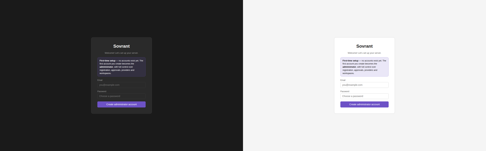

## 2. Chat

**Route:** `/`

The empty state asks "What are you working on?" and offers starter prompts (custom agent, research team, swarm, workflow, multi-agent pipeline, MCP server). Below them is a "What Sovrant can do" strip. The top bar has the model picker ("No model · Add a provider" until a provider exists), the workspace and project selectors, and the Integrations menu. The sidebar lists conversations, with search and folders. The composer has a **Private** toggle and a **+ Remember** control.

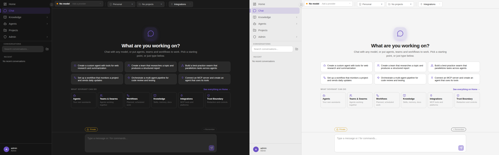

## 3. Home

**Route:** `/dashboard` (rail: Home; `/welcome` redirects here)

"Welcome back" overview: activity counters, a role-aware "Set up Sovrant for your team" checklist (connect a model provider, enable providers for a workspace, add your team, connect an integration, create your first agent), and "What Sovrant can do" cards. The Activity tab shows cross-workspace activity.

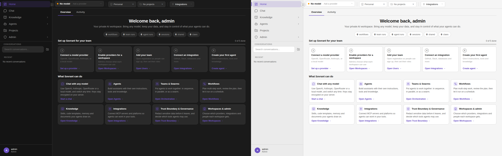

## Knowledge section

### 4. Memory — `/memory`

Notes, patterns, incidents and summaries that agents recall across sessions. Each entry can be marked private.

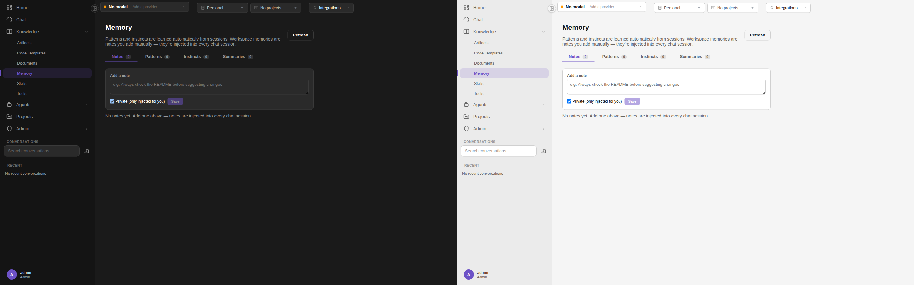

### 5. Documents — `/documents`

Built-in document templates (business, construction, education, …) with output formats; select one to view its details.

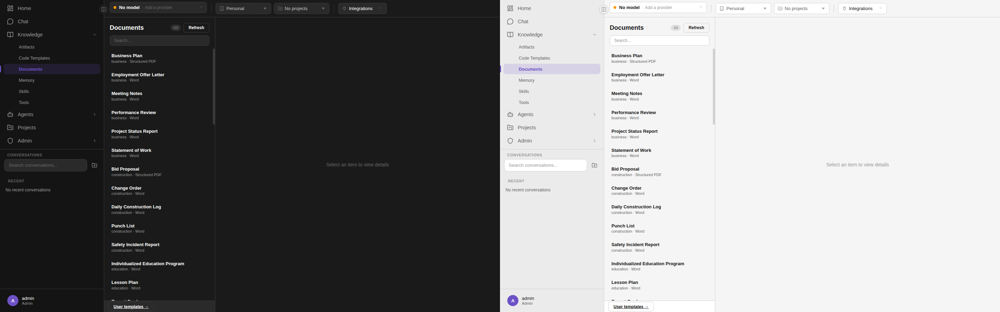

### 6. Document Templates — `/documents/templates`

User-defined document templates (**+ New** to create).

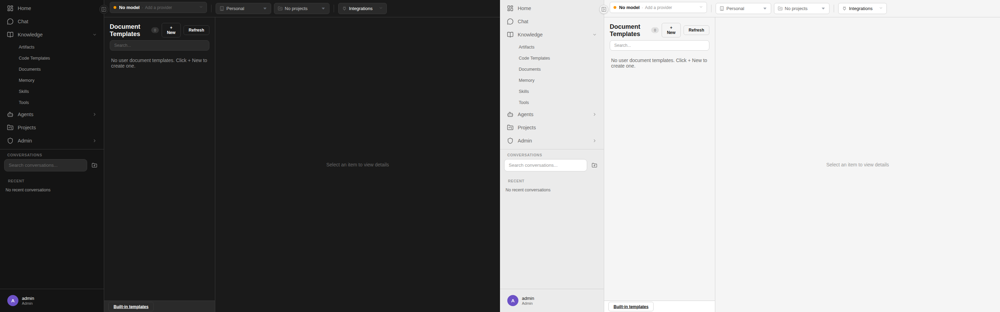

### 7. Artifacts — `/artifacts`

Files produced by agent runs, grouped per run.

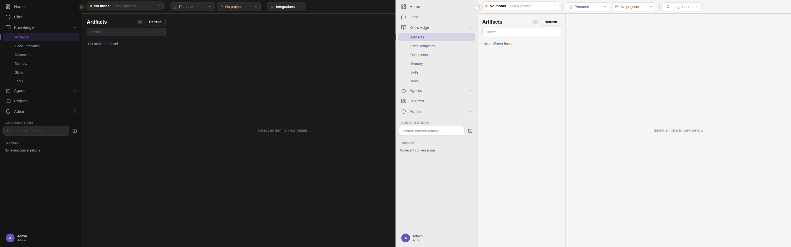

### 8. Code Templates — `/guidelines`

Per-language coding conventions (.NET, C++, Go, Java, Kotlin, Python, Rust, …) that agents follow.

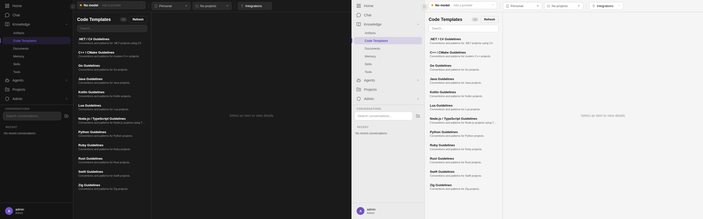

## Agents section

### 9. Library — `/agents`

Built-in agent templates with their tier and tool set, plus recent agent runs.

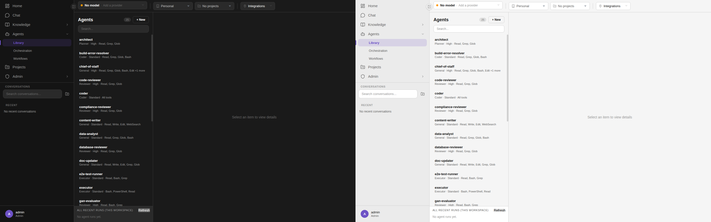

### 10. Skills — `/skills`

The built-in skill catalog with agent and tool counts per skill.

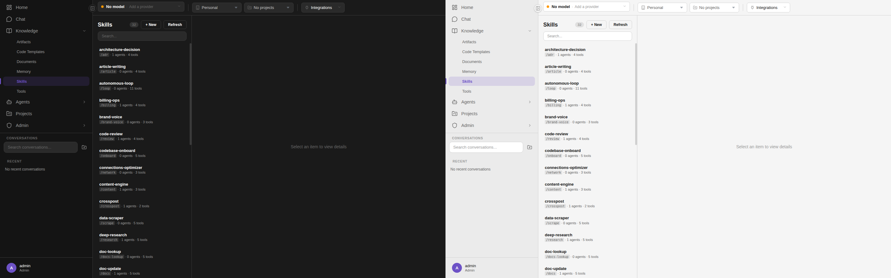

### 11. Tools — `/tools`

Every built-in tool, with a description of each.

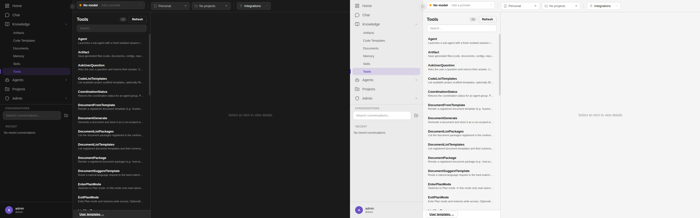

### 12. Tool Templates — `/tools/templates`

Tool templates (e.g. CodeCreate, CodeCreateMulti, CodeValidate).

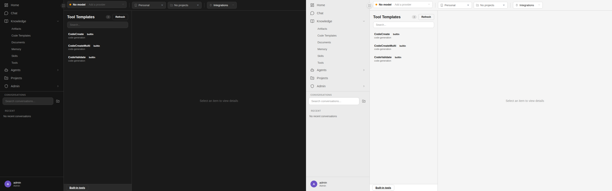

### 13. Orchestration — `/orchestration`

Teams and their default run profiles.

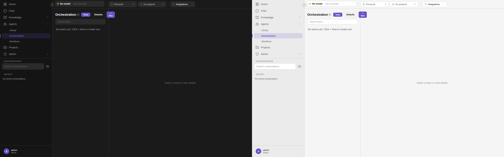

### 14. Workflows — `/workflows`

Planned and scheduled workflows.

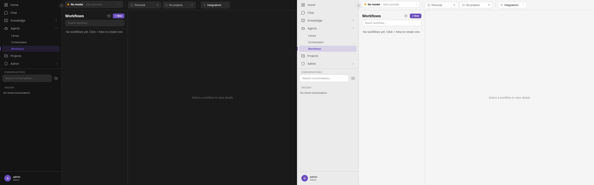

## Projects

### 15. Projects — `/projects`

Create and list projects.

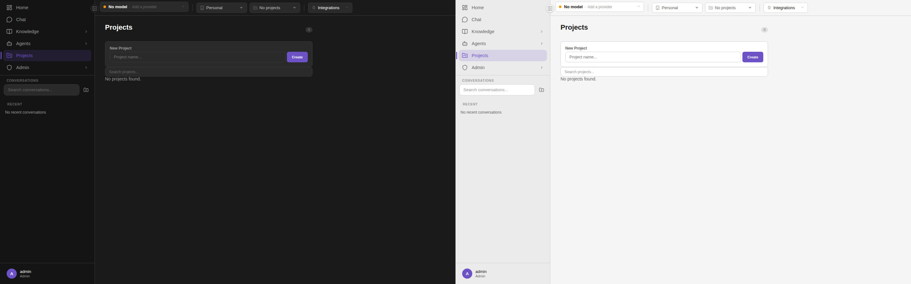

### 16. Workspaces — `/workspaces`

The user's workspaces (Personal by default), with a form to create a team workspace.

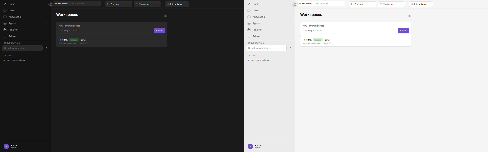

### 17. Code Scaffolds — `/code`

Project scaffolds per stack (C++ CMake, Blazor Server, .NET Console/Web API/Worker, Go, Java, Node, …).

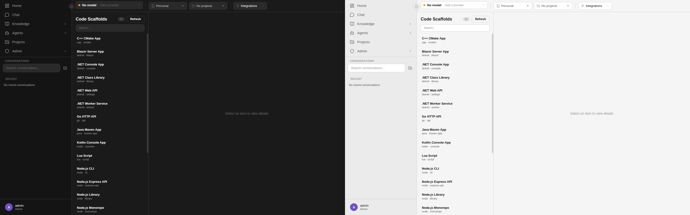

## Settings and provider setup

### 18. Settings — `/settings`

Permission mode, dark/light theme, and sign-out (this browser or all browsers).

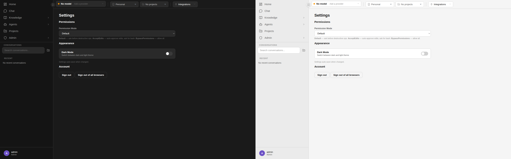

### 19. Provider setup — `/setup`

"Welcome to Sovrant": pick a provider, enter an API key and base URL, then **Get Started**.

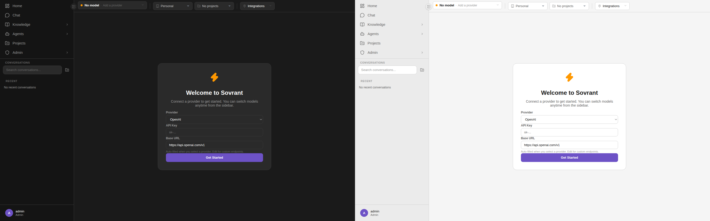

## Admin

### 20. Command Center — `/command`

Live counts of workflows, team runs, agent runs, sessions and Claws, plus what is currently in flight.

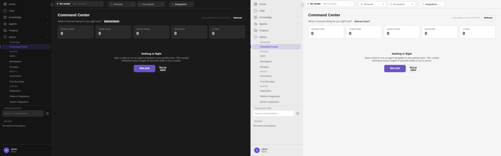

### 21. Users — `/admin`

User list with role and status, plus tabs for Registration & sign-in and Password Reset.

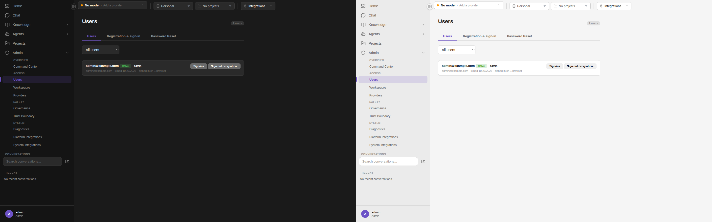

### 22. Providers — `/admin/providers`

Configured LLM providers and an Add Provider form, scoped to workspaces.

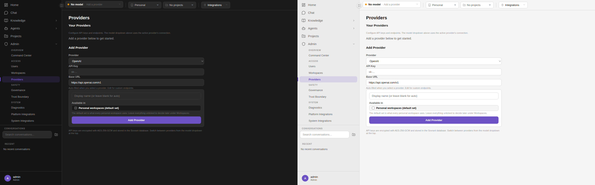

### 23. Platform Integrations — `/admin/integrations`

MCP servers (connected and gallery), with import via JSON, stdio or HTTP.

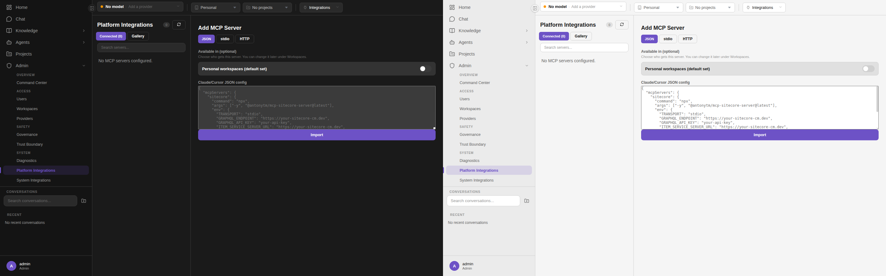

### 24. System Integrations — `/admin/system-integrations`

The active storage backend (SQLite by default) and optional PostgreSQL and Supabase connections.

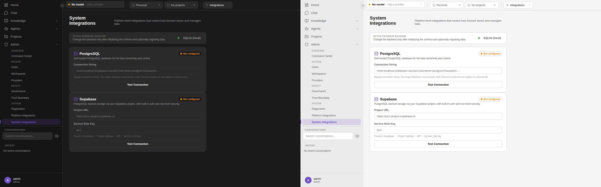

### 25. Workspaces (admin) — `/admin/workspaces`

All team workspaces and the personal-workspace defaults.

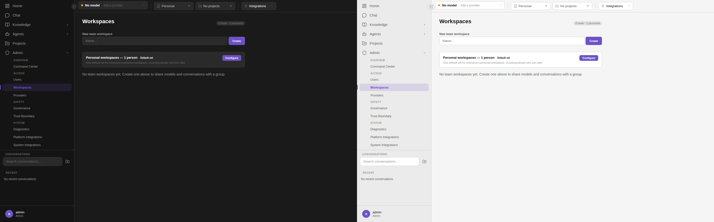

### 26. Governance — `/governance`

Governance level, audit logging, file/shell permissions, blocked commands, protected files and secret-detection patterns.

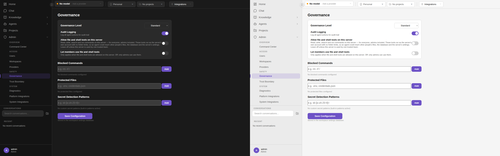

### 27. Diagnostics — `/diagnostics`

System info, health checks (API key, database, artifacts directory, connectivity), provider health and paths.

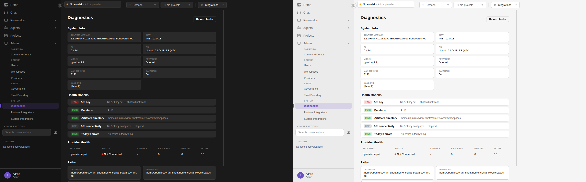

### 28. Trust Boundary — `/trust-boundary`

Master switch, sanitizer mode, corporate domains, allow list, exempt providers, custom patterns and intent verification.

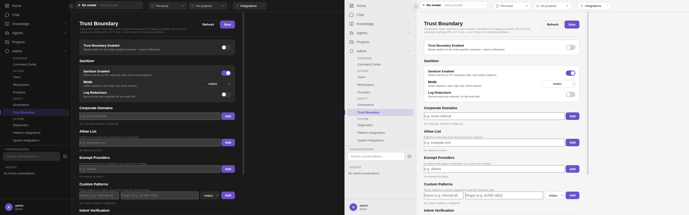
